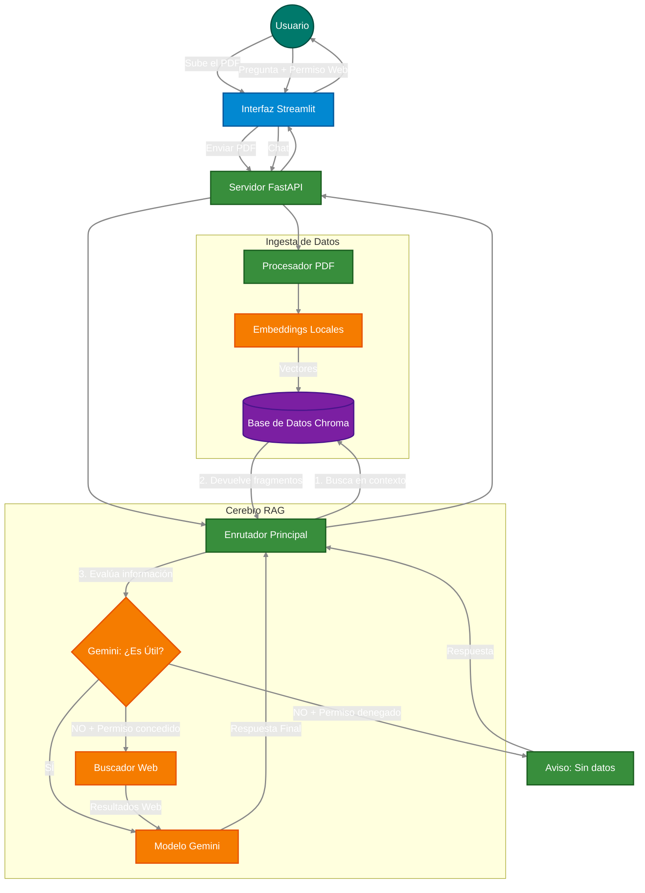

# Hybrid-RAG: Sistema Avanzado de Recuperación de Información

Un sistema *RAG (Retrieval-Augmented Generation)* de nivel empresarial. Esta arquitectura no solo busca información en documentos PDF locales, sino que incorpora un **mecanismo de evaluación semántica** que decide de forma autónoma si debe hacer un *Agentic Fallback* (búsqueda en internet) para responder la pregunta del usuario.

## Características Principales

- **Corrective RAG (CRAG):** El sistema evalúa la relevancia del contexto recuperado antes de generar una respuesta, minimizando las alucinaciones (cero invenciones).
- **Embeddings 100% Locales:** Utiliza el modelo all-MiniLM-L6-v2 de HuggingFace en CPU, garantizando privacidad total de los documentos y cero coste de API en el procesamiento.
- **Agentic Fallback con HITL:** Búsqueda en la web a través de Tavily de forma automatizada cuando el documento no tiene la respuesta, controlada por un interruptor (el usuario decide si permite acceso a internet).
- **Arquitectura Desacoplada:** Backend robusto con **FastAPI** y Frontend interactivo con **Streamlit**.

## Arquitectura y Flujo de Datos

El siguiente diagrama muestra el flujo de decisiones (Routing) y la separación de responsabilidades del proyecto:



## Stack Tecnológico

- **Frontend:** Streamlit
- **Backend:** FastAPI, Pydantic, Uvicorn
- **Orquestación AI:** LangChain
- **Base de Datos Vectorial:** ChromaDB (Embedded local)
- **Modelos:** Google Gemini (LLM) y HuggingFace (Embeddings)
- **Herramientas:** Tavily API (Web Search)

## Instalación y Despliegue Local

### 1. Clonar el repositorio e inicializar el entorno

```bash
git clone https://github.com/tu-usuario/Hybrid-RAG.git
cd Hybrid-RAG

# Crear entorno virtual
python -m venv .venv

# Activar entorno (Windows PowerShell)
.\.venv\Scripts\Activate.ps1
```

### 2. Instalar dependencias

Se recomienda usar `uv` para una instalación ultrarrápida:

```bash
pip install uv
uv pip install -r backend/requirements.txt
```

### 3. Configurar Variables de Entorno

Copia el archivo de ejemplo y añade tus API Keys:

```bash
cp .env.example .env
```
Edita `.env` con tus credenciales:
```env
GOOGLE_API_KEY=tu_clave_de_gemini
TAVILY_API_KEY=tvly-tu_clave_de_tavily
```

### 4. Arrancar los servidores

Ejecuta el Backend y el Frontend en **dos terminales separadas** (ambas con el `.venv` activado).

**Terminal 1 (Backend FastAPI):**
```bash
uvicorn backend.api.server:app --reload
```
*La API estará en `http://localhost:8000` (Swagger en `/docs`).*

**Terminal 2 (Frontend Streamlit):**
```bash
streamlit run frontend/app.py
```
*La interfaz gráfica se abrirá en tu navegador.*